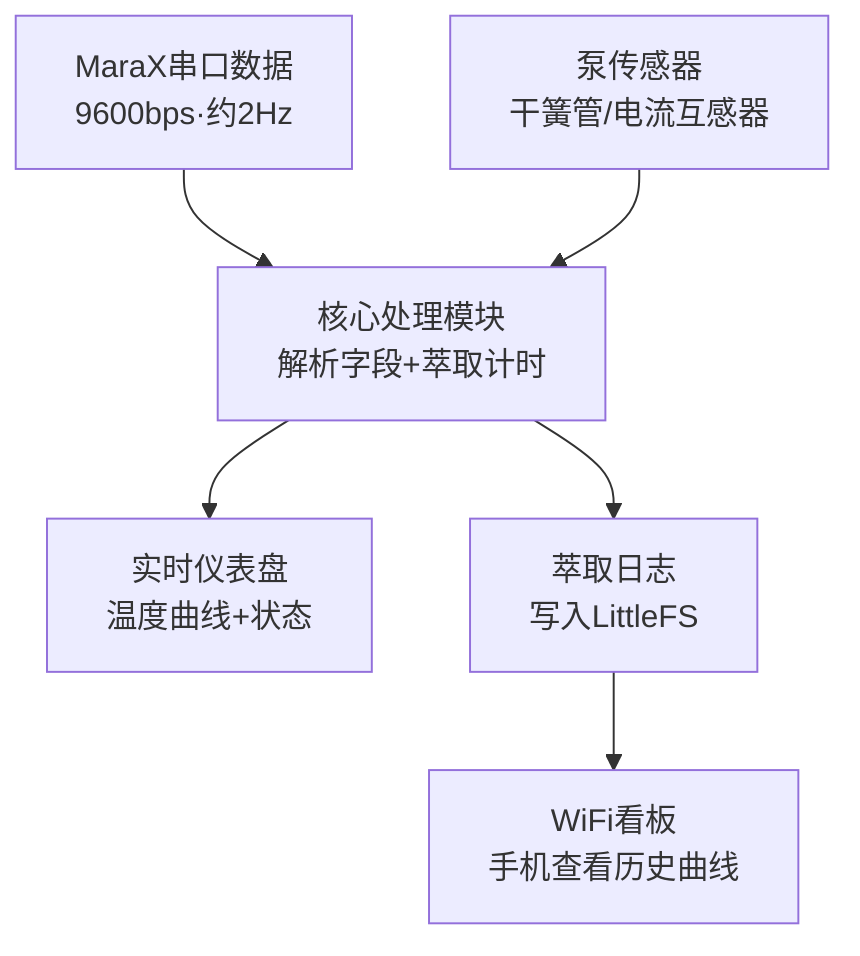

# MaraX 智能监控终端 · 实现方案

> 基于 LilyGO T-Display-S3 (ESP32-S3R8) 对 Lelit MaraX 半自动咖啡机进行**只读**旁路监控改造。
> 本文档面向开发执行（Antigravity 2.0），包含硬件改造指导与完整软件需求。

## 目录

- [一、项目边界与安全原则](#一项目边界与安全原则)
- [二、硬件改造方案](#二硬件改造方案)
- [三、软件架构](#三软件架构)
- [四、数据模型](#四数据模型)
- [五、功能模块需求](#五功能模块需求)
- [六、体验模拟版本（无需真实硬件即可测试）](#六体验模拟版本无需真实硬件即可测试)
- [七、开发优先级与验收标准](#七开发优先级与验收标准)
- [八、参考资料](#八参考资料)

---

## 一、项目边界与安全原则

- **只读监听**：固件全程只监听 MaraX 控制单元串口数据，**不向机器写入任何指令**，不介入其温控 PID 闭环。这是贯穿硬件和软件的最高优先级约束。
- **供电隔离**：监控终端使用独立 USB-C 5V 适配器供电，不从咖啡机取电。
- **强电隔离**：所有新增走线（信号线）与机器内部强电部分（加热棒、锅炉供电、振动泵交流供电）保持物理隔离，仅做非侵入式信号采集。

---

## 二、硬件改造方案

### 2.1 物料清单（BOM）

| 物料 | 数量 | 说明 |
|---|---|---|
| LilyGO T-Display-S3 (ESP32-S3R8, 16MB Flash) | 1 | 现有开发板 |
| 杜邦线 / JST-SH转接线 | 若干 | 用于MaraX 6Pin接口引线 |
| 干簧管（常开型） | 1 | 萃取检测，基础方案 |
| 非侵入式电流互感器（SCT-013 或 ACS712） | 1（可选） | 萃取检测，进阶方案，替代干簧管 |
| 热缩管 | 若干 | 线材绝缘保护 |
| USB-C 5V 电源适配器 + 数据线 | 1 | 独立供电，不占用机器电源 |
| 双面胶 | 少量 | 固定干簧管 |

### 2.2 开发板管脚定义

| 功能 | GPIO | 板载标识 | 说明 |
|---|---|---|---|
| 串口接收 | GPIO18 | U1 RXD | 硬件UART1接收，接收MaraX数据，**主要数据源** |
| 串口发送 | GPIO17 | U1 TXD | 硬件UART1发送，**预留不使用**，固件不得写入 |
| 萃取传感器输入 | GPIO3 | TOUCH03 / ADC1_CH2 | 接干簧管或电流互感器信号，支持数字/模拟两种读取方式 |
| 按键1 | GPIO0 | Boot | **已有按键，无需新增硬件** |
| 按键2 | GPIO14 | IO14 | **已有按键，无需新增硬件** |
| 共地 | GND | — | 与MaraX控制单元共地，是通信正常的前提 |
| 供电 | USB-C口 | — | 板载接口，接独立5V适配器 |

> 屏幕（ST7789, LCD_D0-D7等）、触摸（如有）等板载外设引脚均为出厂固定走线，本次改造**不涉及**，沿用原厂定义即可。

### 2.3 MaraX 侧 6Pin 维修接口定义

| Pin | 定义 | 对接方式 |
|---|---|---|
| Pin2 | GND | 接开发板 GND |
| Pin3 | RX（机器接收） | 接开发板 GPIO17，**预留不用**（如未来需要双向通信可用） |
| Pin4 | TX（机器发送） | 接开发板 GPIO18，**核心数据线** |

协议格式：9600 波特率，纯文本，`\n` 结尾，约每 0.5 秒推送一帧，格式示例：

```
C1.19,116,124,095,0560,0
```

字段依次为：模式标志（`C`=咖啡模式 / `V`=蒸汽模式）+ 固件版本、蒸汽温度、蒸汽目标温度、HX热交换器温度、boost值、加热丝开关状态。萃取动作（泵开关）不在该协议内，需要额外硬件检测。

### 2.4 接线示意图

```
MaraX 6Pin接口                     T-Display-S3 (ESP32-S3R8)
┌───────────────────┐             ┌─────────────────────────┐
│ Pin2 · GND          ├─────────────┤ GND                     │
│ Pin4 · TX(数据输出)  ├─────────────┤ GPIO18 (U1 RXD)  ← 接收 │
│ Pin3 · RX(预留)      ├╌╌╌╌╌╌╌╌╌╌╌╌┤ GPIO17 (U1 TXD)  预留   │
└───────────────────┘             │                         │
                                   │ GPIO3   ← 传感器信号      │
振动泵 ──[干簧管/电流互感器]────────────┤                         │
                                   │ GPIO0   Boot按键(已有)   │
                                   │ GPIO14  IO14按键(已有)   │
                                   │ USB-C   ← 独立5V供电     │
                                   └─────────────────────────┘
```

### 2.5 安装步骤

1. 断开咖啡机电源，拆下机器底部维护盖，找到6Pin维修接口。
2. 从 Pin2 / Pin3 / Pin4 并联引出三根线（不剪断原线，避免影响机器自身功能），建议用 JST-SH 或杜邦线转接。
3. 干簧管用双面胶固定在振动泵外壳表面；若采用电流互感器方案，将其非接触式卡在泵的交流供电线外皮上即可，无需剖线。
4. 走线至外部固定开发板的位置，所有裸露接点用热缩管包裹绝缘。
5. 开发板使用独立 USB-C 电源适配器供电，建议不与咖啡机共用同一插座回路。
6. 上电前用万用表确认 GND 已正确共地；首次通电若无数据，尝试交换 RX/TX 接线（说明标注方向与实际板卡丝印不一致）。

### 2.6 安全须知

- 固件代码中**不得出现任何向 GPIO17（预留TX）主动写入 MaraX 协议指令**的逻辑。
- 传感器与信号线须与机器强电部分保持物理距离，不共用线槽。
- 建议先在断电状态下完成全部走线，确认无短路后再通电测试。

---

## 三、软件架构



模块划分：`SerialParser`（串口解析）、`ShotTimer`（萃取计时）、`DashboardRenderer`（屏幕渲染）、`BrewLogger`（本地日志）、`WebDashboard`（WiFi接口）、`AlertManager`（维护提醒）。

---

## 四、数据模型

```c
// 单帧机器状态读数
struct MaraXReading {
  char mode;              // 'C' 咖啡模式 / 'V' 蒸汽模式
  float steamTemp;        // 蒸汽当前温度
  float steamTarget;      // 蒸汽目标温度
  float hxTemp;           // 热交换器当前温度
  int boost;              // 原始boost值
  bool heaterOn;          // 加热丝开关状态
  bool pumpOn;            // 泵状态（来自传感器，非协议字段）
  unsigned long timestamp;
};

// 单次萃取记录
struct BrewRecord {
  unsigned long startTime;
  unsigned int durationSec;
  float avgHxTemp;
  float tempSamples[30];  // 稀疏采样，用于历史曲线回放
  uint8_t sampleCount;
  bool isSimulated;        // 标记该记录是否来自体验模拟模式
};
```

---

## 五、功能模块需求

### 5.1 SerialParser（串口解析）
- HardwareSerial1，9600bps，RX=GPIO18，TX=GPIO17（配置但不写入）。
- 按 `\n` 分帧，解析出6个逗号分隔字段，更新全局最新 `MaraXReading`。
- 容错：字段数量或格式不符时丢弃该帧，不得导致程序崩溃或死循环。

### 5.2 ShotTimer（萃取计时）
- 监听 GPIO3 边沿（干簧管开关或电流互感器阈值触发）。
- 检测到泵启动开始计时，泵停止结束计时。
- 短于3秒的触发（如机器自动补水造成的误触发）应被过滤，不计入萃取记录。
- 结束后生成一条 `BrewRecord`，推送给 Dashboard 与 BrewLogger。

### 5.3 DashboardRenderer（屏幕渲染，四个视图）

| 视图 | 内容 | 触发方式 |
|---|---|---|
| View1 实时仪表盘（默认页） | HX/蒸汽当前与目标温度大字显示、最近60秒温度曲线滚动图、咖啡/蒸汽模式图标、加热状态指示灯 | 开机默认 |
| View2 萃取计时 | 大字计时秒数 + 实时HX温度同步显示，结束后停留展示本次成绩（耗时+均温）3秒后自动返回View1 | **泵信号自动触发，不响应按键**，保证萃取过程零手动介入 |
| View3 历史记录 | 最近N条萃取记录列表（时间/耗时/均温），可选中查看曲线回放 | BTN1短按（从View1进入） |
| View4 设置 | WiFi配置入口、除垢计数清零、单位切换 | BTN1长按 |

### 5.4 按键状态机（复用现有2个按键，正式版）

| 操作 | 功能 |
|---|---|
| BTN1（GPIO0）短按 | View1 ↔ View3 切换 |
| BTN1 长按（>800ms） | 进入 View4 设置 |
| BTN2（GPIO14）短按 | View3 翻页 / View4 确认选项 |
| BTN2 长按 | 除垢计数清零 / 强制返回 View1 |

### 5.5 BrewLogger（本地日志）
- `BrewRecord` 序列化为JSON行，追加写入 LittleFS `/brewlog.jsonl`。
- 超过200条自动清理最旧记录（FIFO），并维护累计萃取次数计数器（除垢提醒依据）。

### 5.6 WebDashboard（WiFi接口）
- WebServer 提供以下接口：
  - `GET /api/current` → 返回当前 `MaraXReading` 的 JSON
  - `GET /api/history` → 返回 `brewlog.jsonl` 转换后的 JSON 数组
  - `GET /` → 简单网页（Canvas 绘制实时/历史温度曲线）

### 5.7 AlertManager（维护提醒）
- 累计萃取次数超过阈值（默认200次），在 View1 顶部常驻显示除垢提醒图标。

---

## 六、体验模拟版本（无需真实硬件即可测试）

**目的**：在硬件改造完成之前，先用现有的 T-Display-S3 板子（仅靠板载的2个按键）独立验证整套软件的真实使用体验。

### 6.1 总体要求
- 增加编译开关 `#define SIMULATION_MODE`（或通过特定长按组合键在运行时切换）。
- 开启后，`SerialParser` 被 `SimulatedDataGenerator` 替代：无需接入任何外部硬件，内部生成符合协议格式的模拟 `MaraXReading` 数据流——温度从室温缓慢爬升至目标温度，并叠加小幅真实感波动噪声，模拟真实机器的加热曲线。
- **两个按键在模拟模式下的分工**：
  - **BTN1**：功能与正式版完全一致，负责 View1/View3/View4 切换，用于验证菜单导航体验。
  - **BTN2**：从正式版的"翻页/确认"，改为**长按触发一次模拟萃取**——按住即代表"泵开始运转"（自动切入 View2 萃取计时），松开代表萃取结束，自动按照模拟HX温度曲线生成一条 `BrewRecord`（打上 `isSimulated=true` 标记）写入日志。这样无需任何传感器即可完整验证萃取计时、历史记录、曲线回放的全链路。
- 模拟模式下，View1 顶部需常驻明显视觉标识（如黄色 `SIM` 字样），避免误认为真实机器数据。
- 除数据来源和萃取触发方式外，UI渲染、日志存储、WiFi看板逻辑必须与正式版**完全共用同一套代码路径**——体验版验证通过的代码应可直接用于真实硬件，仅需关闭 `SIMULATION_MODE` 并完成硬件接线。

---

## 七、开发优先级与验收标准

### 7.1 建议开发顺序
1. `SIMULATION_MODE` 体验版优先跑通（仪表盘 + 计时 + 日志 + 按键）——不依赖硬件改造进度。
2. 真实 `SerialParser` 对接（上电验证实际协议数据是否符合本文档假设）。
3. `WebDashboard`。
4. `AlertManager` 除垢提醒。

### 7.2 验收清单

- [ ] 体验版可在无任何外部接线情况下，通电即进入 View1 并展示模拟温度曲线。
- [ ] BTN1 短按/长按能正确切换 View1/View3/View4。
- [ ] BTN2 长按能触发一次完整模拟萃取流程，松开后正确写入历史记录并可回放曲线。
- [ ] 模拟模式下 View1 顶部 `SIM` 标识清晰可见。
- [ ] 关闭 `SIMULATION_MODE` 并接入真实 MaraX 后，仪表盘温度与机器面板实际读数一致（±2℃内）。
- [ ] 连续运行4小时无崩溃、无明显内存泄漏（可通过 Serial 打印剩余堆内存验证）。

---

## 八、参考资料

- [bancbanus/marax_monitor](https://github.com/bancbanus/marax_monitor) — 协议解析与ESP8266+Nextion方案参考
- [alexrus/marax_timer](https://github.com/alexrus/marax_timer) — 6Pin接口线序与干簧管萃取计时方案参考
- [jousis/marax_visualizer](https://gitlab.com/jousis/marax_visualizer) — 数据可视化思路参考
- [LilyGO T-Display-S3](https://github.com/Xinyuan-LilyGO/T-Display-S3) — 开发板官方仓库
